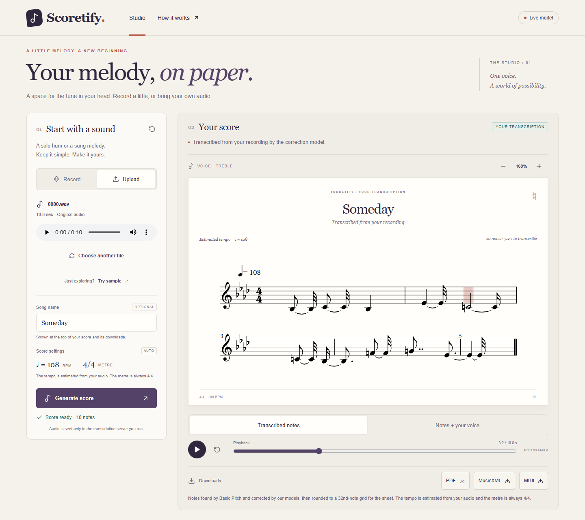

# Scoretify — singing to sheet music

Scoretify turns a solo singing recording into sheet music. It uses Basic Pitch to predict notes, applies five correction steps, and turns the corrected notes into a score. Users can view and play the result, then download PDF, MusicXML or MIDI files.



## Start here

- **Run the application:** the [quick start](#run-the-app) below, or the [Run Guide](RUN_GUIDE.md) for step-by-step setup and troubleshooting.
- **Review the research:** follow the [Scientific Guide](SCIENTIFIC_GUIDE.md) for the dataset, experiments, saved results and limits on reproducing the work.

## What the website does

- **Record** up to 30 seconds in the browser, with a live input-level meter.
- **Upload** an audio file (WAV, MP3, M4A, OGG, WebM or FLAC; up to 30 seconds and 20 MB), or drag and drop it.
- **Try sample** loads a short built-in clip, for exploring without your own audio.
- **Generate score** sends the clip to the model and shows the corrected notes as sheet music, with the estimated tempo and the number of notes.
- **Song name** (optional) becomes the title on the score and in the downloads. You can change it after generating, without running the model again.
- **Listen** to the transcribed notes alone, or mixed with your voice. A cursor follows the score, and you can jump to any point or zoom.
- **Download** the score as **PDF**, **MusicXML** (for MuseScore and other notation apps) or **MIDI**.
- **Reset** clears everything. Errors are explained on the page, for example when no sung notes were found or the server is not running.

## Run the app

You need Python **3.13**, Node.js **22.12+** and Chrome. Keep the project in a short folder path, such as `C:\Projects\Data-Mining-Project`. The commands are for Windows PowerShell, run from the project folder; macOS and Linux notes, a first test and troubleshooting are in the [Run Guide](RUN_GUIDE.md).

```powershell
# Once: install the back end and the front end
py -3.13 -m venv venv
venv\Scripts\python -m pip install -r backend/requirements.txt
venv\Scripts\python -m pip install --no-deps basic-pitch==0.4.0   # --no-deps is required (skips TensorFlow)
cd frontend; npm ci; cd ..

# Every time, terminal 1: the back end (ready when http://127.0.0.1:8000/api/health shows "warmed_up": true)
venv\Scripts\python -m uvicorn app:app --app-dir backend --port 8000

# Every time, terminal 2: the front end, then open http://127.0.0.1:5173
cd frontend; npm run dev
```

## Tech stack

| Part | Technology |
|---|---|
| Front end | React 19, TypeScript and Vite. OpenSheetMusicDisplay draws the score; jsPDF and svg2pdf.js make the PDF; the browser's MediaRecorder and Web Audio record clips and convert them to WAV |
| Back end | Python 3.13 with FastAPI and Uvicorn |
| Model | Basic Pitch (ONNX Runtime) finds the notes; trained scikit-learn and LightGBM models correct them in five steps, using librosa audio features; music21 and pretty_midi write the MusicXML and MIDI |
| Tests | Vitest and Testing Library (unit), Playwright in Chrome (browser) |

## Limitations

- **Background noise, music or other voices.** The models were trained and evaluated only on clean studio recordings of solo singing (GTSinger), and the app does no noise suppression. Noisy recordings have not been tested; expect extra, missing or wrong notes. Record in a quiet room, close to the microphone.
- **Accuracy.** On the test songs, about 41% pitch + note-start F1 (see [Dataset and results](#dataset-and-results)). Treat the score as a draft to correct, not an exact transcription.
- **One melody line**, up to 30 seconds and 20 MB per clip.
- **Simplified notation.** The tempo is estimated and can come out double or half on slow songs. The time signature is always 4/4, the first beat is assumed to be at the start of the recording, and note lengths are rounded to 32nd notes. Lyrics and dynamics are not transcribed.
- **Local demo only.** It runs on one computer, one clip at a time (about 3-8 seconds per 10-second clip). There are no accounts, hosting or saved history.
- **Testing so far:** Windows and Chrome, with a simulated microphone in the automated tests. Real microphones, Safari, mobile browsers and macOS/Linux have not been tested yet.

## How the project developed

1. **Dataset sampling and EDA:** select and freeze the songs, check the files, and explore the data. EDA means exploratory data analysis.
2. **Basic Pitch tuning:** compare settings that turn the pretrained model's signals into notes. The neural network itself was not retrained.
3. **Correction-model handover:** prepare the predicted notes, initial input features and reference targets for the correction experiments.
4. **Correction experiments:** test ways to fix errors in the predicted notes.
5. **Final pipeline:** combine five correction steps: timing, splitting, deletion, start adjustment and end adjustment.
6. **Web application:** connect the final pipeline to recording, upload, score display and downloads.

This is the development sequence. The app does not repeat sampling, tuning or model training when a user uploads audio.

## Where to find the work

| Part | Files and explanation |
|---|---|
| Selected dataset | [Selected songs](selected_100.csv) and [train/validation/test split](split_manifest.csv) |
| Dataset checks and EDA | [EDA notebook](eda/GTSinger_100_EDA_and_BasicPitch.ipynb), with saved tables and charts |
| Basic Pitch tuning | [Tuning notebook](notebooks/GTSinger_100_BasicPitch_Tuning.ipynb), with saved comparisons and selected settings |
| Initial correction handover | [Handover README](notebooks/correction_handover/README.md) and [data dictionary](notebooks/correction_handover/DATA_DICTIONARY.md) |
| Correction experiments | [Experiment reading guide](SCIENTIFIC_GUIDE.md#read-the-stages-in-order) and [later model comparisons](final_pipeline/experiments/) |
| Final pipeline | [Overview and results](final_pipeline/README.md) and [step-by-step explanation](final_pipeline/pipeline.md) |
| Web application | [Front-end code](frontend/src/) and [checks](RUN_GUIDE.md#optional-run-the-automated-checks), and [backend API](backend/README.md) |

Read the saved notebook outputs first. Some historical notebooks need files or environments that are not included here; see the Scientific Guide before trying to rerun them.

### Why there are two correction-handover folders

After BP tuning, the selected predictions became the starting point for correction-model development:

- [basic_pitch_runs/correction_handover/](basic_pitch_runs/correction_handover/) holds the frozen predictions, initial features, reference targets and version records supplied to that work. Do not replace these inputs with corrected notes.
- [notebooks/correction_handover/](notebooks/correction_handover/) holds the review notebooks, correction experiments, helpers and their outputs. Later models extended or replaced some initial features.

The [original proposal](docs/archive/proposal-overview.md) is kept as historical context, not as a description of the final system.

## Dataset and results

The frozen GTSinger sample contains **100 songs and 858 audio excerpts**, split into **60 training, 20 validation and 20 test songs**. Songs do not overlap between splits, but singers can appear in more than one split.

The table uses **pitch + note-start F1**: a score from 0 to 1 that balances how many predicted notes are correct and how many reference notes were found. Higher is better. Scores are calculated per song and averaged equally across songs.

| Comparison | Data used | Before | After |
|---|---|---:|---:|
| Default BP → tuned BP | 20 validation songs | 0.1855 | 0.2726 |
| Tuned BP → final corrected notes | 20 test songs | 0.2397 | 0.4148 |

These rows describe different comparisons on different splits. Validation was used during development; it is not an independent final test. The test results come from the saved final run on 27 October 2026.

These are note-prediction scores, before rounding note times to create sheet music. See the [saved pipeline results](final_pipeline/README.md) for the full results, including scores after sheet-music conversion.
